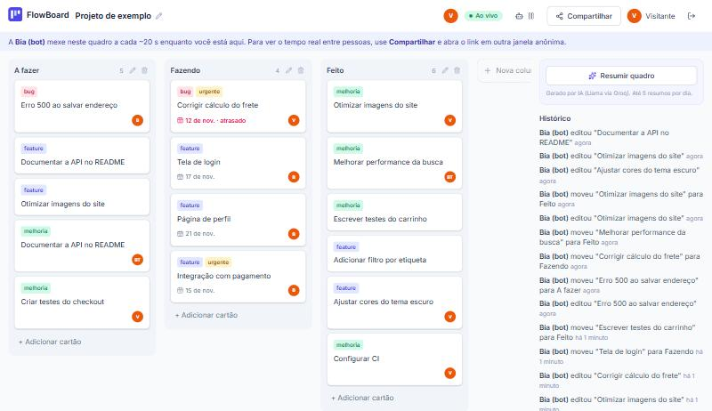
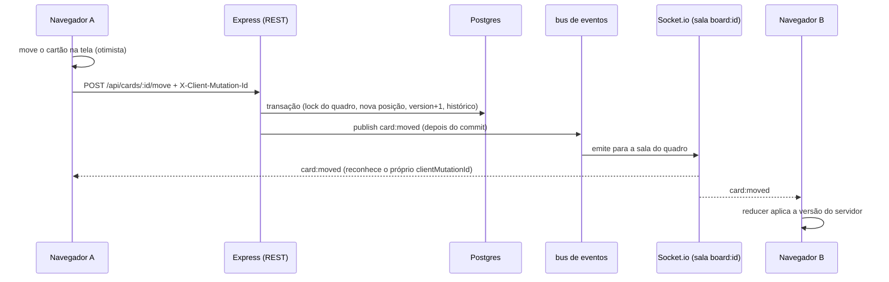

# 🗂️ FlowBoard — Kanban em tempo real

Quadro Kanban colaborativo: arraste um cartão e ele se move na tela de todo mundo que está no quadro, na hora. Tem presença ("Ana está editando este cartão"), histórico, link de convite e um **resumo do quadro feito por IA**.

[](https://github.com/lucasaccioly/kanban-realtime/actions/workflows/ci.yml)




## 🚀 Demo

**Site:** https://flowboard-indol-pi.vercel.app

1. Clique em **Entrar como visitante**: você ganha um quadro de exemplo, sem cadastro.
2. A **Bia (bot)**, uma colega virtual, mexe no quadro a cada ~20 s enquanto você está nele. Assim dá para ver o tempo real funcionando mesmo sozinho.
3. Para ver duas pessoas ao mesmo tempo, use **Compartilhar → Gerar link de convite** e abra o link numa **janela anônima**. Arraste um cartão numa janela e veja a outra mudar.

> ⏳ O servidor roda no plano gratuito do Render, que hiberna sem uso. O site abre na hora com uma prévia do quadro e avisa "Acordando o servidor (até ~1 min)…". Quando o servidor responde, os botões são liberados.

## O que dá para fazer

- **Conta** com e-mail e senha, ou **visitante** (apagado depois de 24 h).
- **Quadros, colunas e cartões**: criar, renomear, apagar e arrastar entre colunas. O cartão tem título, descrição, responsável, prazo e etiquetas (`bug`, `feature`, `urgente`, `melhoria`).
- **Tempo real** via WebSocket: mudanças, quem está online e quem está editando cada cartão.
- **Convite por link**: o dono gera e revoga o link, e remove membros. Membros podem sair do quadro.
- **Histórico** das últimas 50 ações ("Ana moveu 'Login' para Feito há 2 min").
- **Resumo por IA**: progresso por coluna, cartões atrasados ou parados há 3+ dias e próximos passos.

## ⚡ Como o tempo real funciona



- **Mutações por REST, eventos por WebSocket.** Cada mudança passa por uma rota validada com zod, fácil de testar com supertest. O socket só transmite.
- **O servidor é a fonte da verdade.** O evento só sai depois do commit. O cliente aplica a mudança na hora (otimista) e, quando o evento volta, fica com a versão do servidor.
- **Reconexão:** ao reconectar, o cliente entra de novo na sala e troca o estado local pelo do servidor.

## 🧠 Decisões técnicas

| Tema | Decisão |
|---|---|
| **Ordem dos cartões** | Índice fracionário (`fractional-indexing`): a posição é uma string ordenável entre as duas vizinhas, então mover um cartão grava só aquele cartão. |
| **Concorrência** | Mudanças de posição fazem `SELECT ... FOR UPDATE` na linha do quadro, para que dois movimentos simultâneos nunca calculem a mesma posição. Campos usam "última escrita vence", e cada cartão tem `version`. O cliente ignora eventos atrasados com versão menor. |
| **Permissões** | Quem não é membro recebe **404**, nunca 403, e a API não confirma que o quadro existe. Um membro que tenta uma ação de dono recebe 403, porque ele já sabe que o quadro existe. |
| **Expulsão em tempo real** | Ao remover um membro ou apagar o quadro, os sockets dele saem da sala na mesma hora e não recebem mais nenhum evento. Há um teste para isso. |
| **Autenticação** | JWT no header `Authorization`: o site (Vercel) e a API (Render) estão em domínios diferentes, e um cookie de terceiro seria bloqueado. O token fica no `localStorage`. **Trade-off assumido:** isso fica exposto se houver XSS. A mitigação é o React escapar o conteúdo, mais uma CSP restritiva no Vercel. A alternativa seria um proxy no mesmo domínio com cookie httpOnly. |
| **IA gratuita** | Groq (`openai/gpt-oss-20b`, trocável por `GROQ_MODEL`) chamado do servidor com `fetch`, e a chave nunca vai ao navegador. Os limites são 5 resumos por usuário por dia e 200 por dia no total, contados de forma atômica no Postgres. Se o limite acabar ou o Groq falhar, aparece "Resumo indisponível agora…" (com o motivo), a falha devolve a cota e o resto do quadro segue normal. |
| **Colega virtual** | A Bia usa os **mesmos serviços** que um humano, com validação, histórico e eventos. Ela só age em quadros de visitante com alguém online. |
| **Visitantes** | Expiram em 24 h. Os quadros deles somem em cascata e os cartões atribuídos a eles ficam sem responsável. O histórico guarda uma cópia do nome, então continua legível. |
| **Testes com Postgres real** | `embedded-postgres` localmente e Postgres 17 no CI, sem mocks de banco. Os testes de tempo real sobem um servidor Socket.io de verdade e conectam com `socket.io-client`. |

**Próximo passo para escalar:** hoje roda numa instância só, com presença e limites de requisição em memória. Para várias instâncias, entraria o Redis adapter do Socket.io e um Redis para presença e rate limit.

## 📡 API

| Método | Rota | Descrição |
|---|---|---|
| POST | `/api/auth/register` · `/login` · `/guest` | Conta, login, visitante (devolve token) |
| GET | `/api/auth/me` | Usuário atual |
| GET · POST | `/api/boards` | Meus quadros · criar |
| GET · PATCH · DELETE | `/api/boards/:id` | Estado completo · renomear · apagar (dono) |
| POST · DELETE | `/api/boards/:id/invite` | Gerar · revogar link (dono) |
| POST | `/api/invites/:token/join` | Entrar pelo convite |
| POST | `/api/boards/:id/leave` | Sair do quadro |
| DELETE | `/api/boards/:id/members/:userId` | Remover membro (dono) |
| POST | `/api/boards/:id/columns` | Nova coluna |
| PATCH · DELETE | `/api/columns/:id` | Renomear/reordenar · apagar |
| POST | `/api/columns/:id/cards` | Novo cartão |
| PATCH · DELETE | `/api/cards/:id` | Editar · apagar cartão |
| POST | `/api/cards/:id/move` | Mover (`columnId`, `afterCardId`, `version`) |
| POST | `/api/boards/:id/summary` | Resumo por IA |
| PATCH | `/api/boards/:id/bot` | Pausar/retomar a Bia (quadro de visitante) |

**Eventos do Socket.io:**

- O cliente envia `board:join`, `board:leave` e `card:focus`.
- O servidor envia:
  - `card:created|updated|moved|deleted`
  - `column:created|updated|deleted`
  - `board:updated|deleted`
  - `member:joined|left`
  - `activity:new`
  - `presence:update`
  - `board:removed`

## 💻 Rodando localmente

Requisitos: Node 22 ou mais novo. Não precisa de Docker, porque o Postgres vem do npm.

```bash
npm install
cp server/.env.example server/.env
npm run dev   # Postgres na porta 54330, API na 3002 e site na 5174
```

Em outro terminal, crie as tabelas uma vez com `npm run migrate -w server`. Depois abra http://localhost:5174.

| Variável (server) | Uso |
|---|---|
| `DATABASE_URL` | Postgres |
| `JWT_SECRET` | Chave HS256. O `render.yaml` gera uma aleatória. |
| `WEB_ORIGIN` | Origem do site (CORS e Socket.io) |
| `GROQ_API_KEY` | Opcional. Sem ela, o resumo mostra a mensagem de indisponível. |
| `AI_GLOBAL_DAILY` / `BOT_INTERVAL_MS` / `TRUST_PROXY` | Teto diário de IA (200), intervalo da Bia (20000 ms), proxies confiáveis |

No site, `VITE_API_URL` aponta para a API (padrão `http://localhost:3002`).

## ✅ Testes

```bash
npm test
```

São 81 testes. No servidor, Vitest, supertest e socket.io-client rodam contra Postgres real e cobrem:

- Autenticação e limites de requisição.
- Permissões (404 e 403).
- Ordenação e movimentação entre colunas.
- Movimentos simultâneos do mesmo cartão terminando no mesmo estado nos dois clientes.
- Expulsão em tempo real.
- Limpeza de visitantes.
- A colega virtual.
- As cotas de IA.

No site, os testes cobrem o reducer que concilia o estado otimista com os eventos do servidor. O CI roda tudo a cada push.

## Licença

[MIT](LICENSE) © Lucas Accioly
